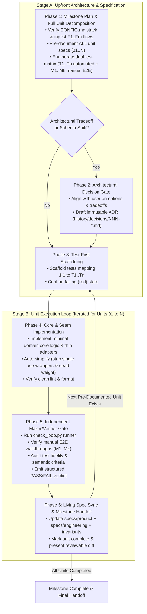

# loop-engineering

An end-to-end engineering operating system for building maintainable, high-integrity software. It transforms ad-hoc coding into a repeatable, spec-and-test-driven development loop.

---

## Core Tenets & System Invariants

1. **Upfront End-to-End Pre-Documentation**:
   Before writing implementation code for Unit 01, decompose the entire milestone/epic into all its sequential Build Units ($01..N$). **Pre-document every unit contract upfront** in `active/NN-<milestone>/units/` with its scope boundaries, architectural seams, dual test matrix (automated $T_1..T_n$ and manual E2E $M_1..M_k$), and acceptance criteria. Never leave downstream phases as vague one-liners.
   $$\text{Living Spec / Roadmap} \longrightarrow \text{Pre-Document All Units } (01..N) \longrightarrow \text{Iterate } [\text{Test} \to \text{Build} \to \text{Verify} \to \text{Finalize}]$$

2. **Dual-Layer Spec-and-Test Traceability (Automated + Manual E2E)**:
   Every unit must define two complementary test layers before implementation:
   - **Automated Test Scenarios ($T_1..T_n$)**: Programmatic, deterministic CI unit/integration tests mapping 1:1 to explicit scenario tokens. For UI work, behavior that only exists in a browser (hover, focus, keyboard, JS-driven state, layout/overflow, accessible names) gets **automated browser tests** (Playwright or equivalent) named by the same tokens; source-text assertions don't count as covering it.
   - **Manual E2E Scenarios ($M_1..M_k$)**: Concrete, step-by-step user-verifiable browser/device walkthroughs specifying exact user actions, expected visual changes, and error recovery states. They cover what automation can't judge (visual feel, third-party pages) and act as a human sanity pass over key flows, even ones the browser suite already automates.

3. **Architectural Seams & Determinism**:
   Deterministic domain logic lives in isolated core modules (`lib/`, domain packages, core models). Route handlers, API endpoints, and CLI tools are thin adapters. Multitenancy, permissions, and scoping boundaries are enforced structurally at the data access seam, making unscoped leaks impossible.

4. **Maker / Verifier Independence**:
   The session or agent that writes the code **must not self-approve** its own work. An independent verification pass audits mechanical CI facts, test fidelity, manual E2E repeatability, and semantic acceptance criteria without maker rationalization.

5. **Living Documentation & Safe Git Hygiene**:
   Three top-level documentation directories, by lifecycle:
   ```
   active/                       # work in progress
     NN-<milestone>/
       plan.md                   # roadmap + status tracker
       units/NN-<slug>.md        # unit contracts
   specs/                        # what the system is today
     README.md                   # index: system overview, links to both halves
     product/                    # what & why
     engineering/                # how
   history/                      # append-only record of change
     decisions/NNN-<slug>.md     # ADRs
     milestones/NN-<milestone>/  # finished active/ folders, moved here intact
   ```
   - **Active work (`active/NN-<milestone>/`)**: the milestone plan (unit sequence, target end state, migration matrices, status tracker) and its unit contracts. Planning artifacts never live in `specs/`.
   - **Living Specs (`specs/`)**: source of truth for what the system does *today*. Describe only what has shipped: no roadmaps, unbuilt features, or "will" statements. Never use strikethroughs or describe decommissioned designs. Gaps between intent and reality are listed explicitly as **Known Gaps**. A spec outlives the milestone that created it.
     - **`specs/product/`**: requirements from the user's side: who it is for, goals, required capabilities and content, constraints, non-goals. Can be a single short `README.md` for small products.
     - **`specs/engineering/`**: design from the builder's side, one file per system layer / subsystem (e.g. `platform.md`, `contact.md`), never per milestone.
   - **History (`history/`)**:
     - **Decision Records (`history/decisions/NNN-*.md`)**: ADRs capturing *why* choices, pivots, and cuts occurred. Written here directly when the decision is made. Once accepted, never edited; a new ADR supersedes an old one.
     - **Completed Milestones (`history/milestones/NN-*/`)**: when every unit is done, move the whole `active/NN-*/` folder here. Contracts are then frozen.
   - **Git Safety**: Never auto-commit without explicit user instruction. Leave diffs staged/uncommitted for human inspection.

---

## The 6-Phase Engineering Loop



---

### Phase 1: Milestone Planning & Full Unit Pre-Documentation

**Goal**: Iron out architectural seams, edge cases, and dependencies by pre-documenting all build units across the entire milestone *before* touching code.

1. **Product Framing & Stack Alignment**:
   - Inspect `CONFIG.md` and ensure `TEST_COMMAND`, `LINT_COMMAND`, and `FORMAT_COMMAND` match the repository's tech stack.
   - Define user outcomes, high-level user stories, and strict out-of-scope boundaries. If `specs/product/` already defines scoped requirements and Key User Flows ($F_1..F_m$), ingest them directly.
   - Frame tradeoffs in terms of user experience (gains vs. losses) and concrete engineering cost. If non-obvious architectural forks exist, **ask the user first** with concrete options before generating unit files.
2. **Decompose Entire Milestone Upfront**:
   - Break the initiative into sequential, bounded Build Units ($01..N$).
   - Create a dedicated unit spec for **every single unit** upfront using `templates/UNIT_TEMPLATE.md` under `active/NN-<milestone>/units/NN-<slug>.md`.
   - Ensure no unit is left as an unspecified placeholder.
   - Write the milestone roadmap and status tracker (unit sequence, target end state, migration matrices) to `active/NN-<milestone>/plan.md`. Do **not** put it in `specs/`.
   - In each unit contract, fill **Living Specs Affected**: which `specs/product/` and `specs/engineering/` files the unit will create or update once it ships.
3. **Formulate Dual Test Matrix for Every Unit**:
   - Map product user flows ($F_1..F_m$) and edge cases directly into each unit's test scenarios:
   - **Part A: Automated Test Scenarios ($T_1..T_n$)**: Programmatic CI assertions:
     - `- **T1 [Happy Path]** — ...`
     - `- **T2 [Edge Case / Malformed Input]** — ...`
     - `- **T3 [Boundary / Security / Invariant]** — ...`
   - **Part B: Manual E2E Scenarios ($M_1..M_k$)**: Step-by-step user-verifiable browser/device walkthroughs:
     - `- **M1 [Desktop Happy Path]** — Steps: 1. ... 2. ... Expected: ...`
     - `- **M2 [Mobile / Responsive State]** — Steps: 1. ... Expected: ...`
     - `- **M3 [Error State & Recovery]** — Steps: 1. ... Expected: ...`
4. **Validate Seam & Dependency Topology**:
   - Check data flow between units: Does Unit 02 rely on a schema or seam that Unit 01 fails to output?
   - Resolve schema, API, or contract conflicts before any code is written.

---

### Phase 2: Architectural Decision Gate

**Goal**: Lock in non-obvious technical choices, migrations, API selections, or structural cuts in immutable ADRs.

1. **Trigger Conditions**:
   - Framework or runtime selections, schema migrations, third-party API provider choices, security boundaries, or deliberate cuts of planned scope.
2. **Align First, Then Draft the ADR**:
   - Present the options, user/technical tradeoffs, and recommended choice to the user before locking in a major decision.
   - Once aligned, write `templates/ADR_TEMPLATE.md` under `history/decisions/NNN-<slug>.md`.
   - Capture:
     - **Context & Problem Statement**: User friction and engineering constraints.
     - **Decision**: Concrete architectural choice and boundary enforcement.
     - **Alternatives Considered & Rejected**: Concrete user/technical reasons why alternatives were dismissed.
     - **Consequences & Tradeoffs**: Explicit gains and accepted costs.

---

### Phase 3: Test-First Scaffolding

**Goal**: Write deterministic tests mapping 1:1 to the unit's pre-documented $T_1..T_n$ matrix before touching production logic.

1. **Scaffold Test Suite**:
   - Place in `tests/<subsystem>/` or configured test directory.
   - Name test functions with matching test tokens (e.g. `test_t1_happy_path`, `test_t2_honeypot_trap`).
2. **Injectable & Deterministic I/O**:
   - Mock external networks, third-party APIs (e.g. Resend, Stripe), system clocks, or AI model calls.
   - Tests must run fast, offline, and deterministically.
   - The configured `TEST_COMMAND` runs every suite (unit + browser), so the gate in Phase 5 sees both.
3. **Verify Red State**:
   - Run tests to confirm they fail for the expected reasons prior to implementation.

---

### Phase 4: Core & Seam Implementation

**Goal**: Implement minimal, high-integrity code satisfying the unit contract and passing all tests.

1. **Domain Logic in Core First**:
   - Implement business logic, validations, and data models inside pure core packages/modules.
   - Keep deterministic business rules out of LLM prompts and out of thin UI glue.
2. **Thin Web/API/CLI Adapters Second**:
   - Wire route handlers, controllers, templates, and CLI endpoints.
   - Enforce multitenancy and scoping at the data access seam.
3. **Simplify & Clean Code Baseline**:
   - Once tests pass, perform an automatic simplification pass on modified files: inline single-use wrappers, remove speculative abstractions, and strip redundant comments.
   - Verify all unit tests still pass green.
   - Run project linter and formatter (via configured `LINT_COMMAND` and `FORMAT_COMMAND`).

---

### Phase 5: Independent Maker/Verifier Gate

**Goal**: Perform an independent, multi-tiered audit of the implementation against the pre-documented acceptance criteria.

> [!IMPORTANT]
> **Independence Invariant**: The maker agent never signs off on its own work. A separate verification pass audits code, test assertions, manual E2E reproducibility, and observed behavior against the unit spec without rationalization.

1. **Mechanical CI Gate (Deterministic)**:
   Run the verification runner:
   ```bash
   python .agent/skills/loop-engineering/scripts/check_loop.py NN
   ```
   Inspect emitted JSON facts:
   - Test suite exit code & summary.
   - Linter & formatter exit codes.
   - Full mapping of $T_1..T_n$ test tokens (zero missing test tokens permitted).
2. **Manual E2E Walkthrough Audit (Verification)**:
   - Step through each documented manual scenario ($M_1..M_k$).
   - Verify that UI components, responsive breakpoints, error recovery states, and navigation routes function as specified.
3. **Test Fidelity Audit (Judgment)**:
   - Verify assertions are substantive, not tautological or hollow.
   - Check that error branches explicitly assert status codes, error types, and error messages.
4. **Semantic Acceptance Criteria Audit (Judgment)**:
   - Audit every checkbox item in the unit spec's `Acceptance Criteria` against actual code and runtime behavior.
5. **Structured Verdict Table**:
   Emit a clean sign-off table:
   ```markdown
   ### Unit NN — <Unit Name> Verification Verdict
   | Criterion / Gate | Status | Evidence |
   | :--- | :--- | :--- |
   | Automated Tests (T1..Tn) | PASS | n/n mapped and passing green |
   | Manual E2E Tests (M1..Mk) | PASS | All browser walkthroughs verified |
   | CI & Linter Gates | PASS | Tests green; 0 lint/format warnings |
   | Seam & Architecture Invariants | PASS | Logic isolated in core; scoping verified |
   | Semantic Acceptance Criteria | PASS | All bullet criteria verified |
   | **OVERALL VERDICT** | **PASS** | **Ready for living spec sync** |
   ```

---

### Phase 6: Living Spec Sync & Milestone Handoff

**Goal**: Synchronize living specifications with current production reality and prepare clean diffs for human review.

1. **Sync Living Specs & Compound Learnings** (mandatory; a unit is not complete until this is done):
   - Create or update every spec listed under the unit's **Living Specs Affected**, plus any other area the unit actually changed: `specs/engineering/<subsystem>.md` (use `templates/LIVING_SPEC_TEMPLATE.md`) and, if requirements changed, `specs/product/` (use `templates/PRODUCT_SPEC_TEMPLATE.md`).
   - Document shipped behavior from the code, not from the unit contract. Where the contract and the code differ, the spec follows the code and lists the difference under **Known Gaps**.
   - Record any non-obvious domain invariants discovered during implementation or verification in `specs/engineering/<subsystem>.md`, and update `CONFIG.md` if repository tooling quirks were encountered.
   - Update `specs/README.md` (index, route/module map) if routes, modules, or env vars changed.
   - Remove obsolete architectural descriptions (no strikethroughs).
2. **Update Unit Status**:
   - Mark acceptance criteria checkboxes complete in `active/NN-*/units/NN-*.md`.
   - Update the unit's status row in `active/NN-*/plan.md`.
   - Document any manual testing notes or observations.
   - If next pre-documented unit exists, queue it for Phase 3. If this was the last unit, move `active/NN-*/` to `history/milestones/NN-*/`.
3. **Clean Review State**:
   - Present a concise summary of user impact, modified files, test results, and exact manual E2E test steps for the user.
   - Leave diffs uncommitted for human review. Never auto-commit.

---

## Stage Progression & Human Checkpoints

Do not force the user to remember or type phase subcommands. Inspect `active/`, `specs/`, and `tests/` to determine where work stands and advance naturally:

1. **Upfront Planning Checkpoint (Phases 1–2)**: Align with the user on any architectural tradeoffs first, generate `active/NN-<milestone>/plan.md` + all unit contracts (`01..N`) + any ADRs, and pause for approval to start building.
2. **Per-Unit Execution Checkpoint (Phases 3–6)**: For the current incomplete unit in `active/NN-*/plan.md`, run **Phase 3 (Test-First) $\to$ Phase 4 (Build & Simplify) $\to$ Phase 5 (Independent Verify) $\to$ Phase 6 (Spec Sync)** in one cohesive sequence, then pause to present the verdict table, manual E2E walkthrough steps, and uncommitted diff before advancing to the next unit.
