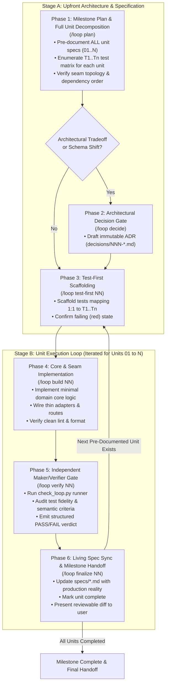

# loop-engineering

An end-to-end engineering operating system for building maintainable, high-integrity software. It transforms ad-hoc coding into a repeatable, spec-and-test-driven development loop.

---

## Core Tenets & System Invariants

1. **Upfront End-to-End Pre-Documentation**:
   Before writing implementation code for Unit 01, decompose the entire milestone/epic into all its sequential Build Units ($01..N$). **Pre-document every unit contract upfront** in `history/units/` with its scope boundaries, architectural seams, explicit test matrix ($T_1..T_n$), and acceptance criteria. Never leave downstream phases as vague one-liners.
   $$\text{Living Spec / Roadmap} \longrightarrow \text{Pre-Document All Units } (01..N) \longrightarrow \text{Iterate } [\text{Test} \to \text{Build} \to \text{Verify} \to \text{Finalize}]$$

2. **Spec-and-Test Traceability**:
   Every code change maps directly to an enumerated test scenario ID ($T_1..T_n$) defined in that unit's specification. No unmapped tests; no untested features.

3. **Architectural Seams & Determinism**:
   Deterministic domain logic lives in isolated core modules (`lib/`, domain packages, core models). Route handlers, API endpoints, and CLI tools are thin adapters. Multitenancy, permissions, and scoping boundaries are enforced structurally at the data access seam, making unscoped leaks impossible.

4. **Maker / Verifier Independence**:
   The session or agent that writes the code **must not self-approve** its own work. An independent verification pass audits mechanical CI facts, test fidelity, and semantic acceptance criteria without maker rationalization.

5. **Living Documentation & Safe Git Hygiene**:
   - **Living Specs (`specs/*.md`, `DESIGN.md`)**: Source of truth for what the system does *today*. Never use strikethroughs or describe decommissioned architectures.
   - **Decision Records (`decisions/NNN-*.md`)**: Immutable ADRs capturing *why* choices, pivots, and cuts occurred. Once accepted, they are never edited; future changes supersede them via a new ADR.
   - **Historical Build Units (`history/units/NN-*.md`)**: Completed milestone contracts with frozen acceptance criteria and mapped test cases.
   - **Git Safety**: Never auto-commit without explicit user instruction. Leave diffs staged/uncommitted for human inspection.

---

## The 6-Phase Engineering Loop



---

### Phase 1: Milestone Planning & Full Unit Pre-Documentation (`/loop plan [milestone/unit]`)

**Goal**: Iron out architectural seams, edge cases, and dependencies by pre-documenting all build units across the entire milestone *before* touching code.

1. **Product Framing**:
   - Define user outcomes, high-level user stories, and strict out-of-scope boundaries.
   - Frame tradeoffs in terms of user experience (gains vs. losses), not raw implementation details.
2. **Decompose Entire Milestone Upfront**:
   - Break the initiative into sequential, bounded Build Units ($01..N$).
   - Create a dedicated unit spec for **every single unit** upfront using `templates/UNIT_TEMPLATE.md` under `history/units/NN-<slug>.md`.
   - Ensure no unit is left as an unspecified placeholder.
3. **Formulate Test Matrix ($T_1..T_n$) for Every Unit**:
   - Enumerate explicit, bold test IDs for each unit:
     - `- **T1 [Happy Path]** — ...`
     - `- **T2 [Edge Case / Malformed Input]** — ...`
     - `- **T3 [Boundary / Security / Invariant]** — ...`
4. **Validate Seam & Dependency Topology**:
   - Check data flow between units: Does Unit 02 rely on a schema or seam that Unit 01 fails to output?
   - Resolve schema, API, or contract conflicts before any code is written.

---

### Phase 2: Architectural Decision Gate (`/loop decide [title]`)

**Goal**: Lock in non-obvious technical choices, migrations, API selections, or structural cuts in immutable ADRs.

1. **Trigger Conditions**:
   - Framework or runtime selections, schema migrations, third-party API provider choices, security boundaries, or deliberate cuts of planned scope.
2. **Draft the ADR**:
   - Use `templates/ADR_TEMPLATE.md` under `decisions/NNN-<slug>.md`.
   - Capture:
     - **Context & Problem Statement**: User friction and engineering constraints.
     - **Decision**: Concrete architectural choice and boundary enforcement.
     - **Alternatives Considered & Rejected**: Concrete user/technical reasons why alternatives were dismissed.
     - **Consequences & Tradeoffs**: Explicit gains and accepted costs.

---

### Phase 3: Test-First Scaffolding (`/loop test-first <unit>`)

**Goal**: Write deterministic tests mapping 1:1 to the unit's pre-documented $T_1..T_n$ matrix before touching production logic.

1. **Scaffold Test Suite**:
   - Place in `tests/<subsystem>/` or configured test directory.
   - Name test functions with matching test tokens (e.g. `test_t1_happy_path`, `test_t2_honeypot_trap`).
2. **Injectable & Deterministic I/O**:
   - Mock external networks, third-party APIs (e.g. Resend, Stripe), system clocks, or AI model calls.
   - Tests must run fast, offline, and deterministically.
3. **Verify Red State**:
   - Run tests to confirm they fail for the expected reasons prior to implementation.

---

### Phase 4: Core & Seam Implementation (`/loop build <unit>`)

**Goal**: Implement minimal, high-integrity code satisfying the unit contract and passing all tests.

1. **Domain Logic in Core First**:
   - Implement business logic, validations, and data models inside pure core packages/modules.
   - Keep deterministic business rules out of LLM prompts and out of thin UI glue.
2. **Thin Web/API/CLI Adapters Second**:
   - Wire route handlers, controllers, templates, and CLI endpoints.
   - Enforce multitenancy and scoping at the data access seam.
3. **Clean Code Baseline**:
   - Verify all unit tests pass green.
   - Run project linter and formatter (e.g. `ruff check .` / `eslint`, `ruff format` / `prettier`).

---

### Phase 5: Independent Maker/Verifier Gate (`/loop verify <unit>`)

**Goal**: Perform an independent, multi-tiered audit of the implementation against the pre-documented acceptance criteria.

> [!IMPORTANT]
> **Independence Invariant**: The maker agent never signs off on its own work. A separate verification pass audits code, test assertions, and observed behavior against the unit spec without rationalization.

1. **Mechanical CI Gate (Deterministic)**:
   Run the verification runner:
   ```bash
   python .agent/skills/loop-engineering/scripts/check_loop.py NN
   ```
   Inspect emitted JSON facts:
   - Test suite exit code & summary.
   - Linter & formatter exit codes.
   - Full mapping of $T_1..T_n$ test tokens (zero missing test tokens permitted).
2. **Test Fidelity Audit (Judgment)**:
   - Verify assertions are substantive, not tautological or hollow.
   - Check that error branches explicitly assert status codes, error types, and error messages.
3. **Semantic Acceptance Criteria Audit (Judgment)**:
   - Audit every checkbox item in the unit spec's `Acceptance Criteria` against actual code and runtime behavior.
4. **Structured Verdict Table**:
   Emit a clean sign-off table:
   ```markdown
   ### Unit NN — <Unit Name> Verification Verdict
   | Criterion / Gate | Status | Evidence |
   | :--- | :--- | :--- |
   | Test Mapping (T1..Tn) | PASS | n/n mapped and asserting correctly |
   | CI & Linter Gates | PASS | Tests green; 0 lint/format warnings |
   | Seam & Architecture Invariants | PASS | Logic isolated in core; scoping verified |
   | Semantic Acceptance Criteria | PASS | All bullet criteria verified |
   | **OVERALL VERDICT** | **PASS** | **Ready for living spec sync** |
   ```

---

### Phase 6: Living Spec Sync & Milestone Handoff (`/loop finalize <unit>`)

**Goal**: Synchronize living specifications with current production reality and prepare clean diffs for human review.

1. **Sync Living Specs**:
   - Update `specs/<subsystem>.md` and `DESIGN.md` to reflect current behavior.
   - Remove obsolete architectural descriptions (no strikethroughs).
2. **Update Unit Status**:
   - Mark acceptance criteria checkboxes complete in `history/units/NN-*.md`.
   - If next pre-documented unit exists, queue it for Phase 3.
3. **Clean Review State**:
   - Present a concise summary of user impact, modified files, and test results.
   - Leave diffs uncommitted for human review. Never auto-commit.

---

## Quick Reference Commands

| Command | Action | Output / Gate |
| :--- | :--- | :--- |
| `/loop plan <name>` | Decompose milestone & pre-document ALL units | Complete set of `history/units/01..N-*.md` with $T_1..T_n$ |
| `/loop decide <title>` | Record architectural pivot / decision | Immutable record in `decisions/NNN-*.md` |
| `/loop test-first <unit>` | Scaffold test suite mapping $T_1..T_n$ | Deterministic test scaffolding verified in red state |
| `/loop build <unit>` | Implement core domain & thin adapters | Passing tests + zero linter/formatter errors |
| `/loop verify <unit>` | Independent maker/verifier audit | Structured PASS/FAIL criteria verdict table |
| `/loop finalize <unit>` | Sync living specs & handoff | Updated `specs/`, marked unit contract, staged diff |
