# product-design

Designs a landing page, app screen or dashboard by producing several genuinely different directions, instead of one templated result. Left alone, AI design converges on the average: gradient hero, text on the left, three feature cards. This skill forces variety from outside, using a random seed per variant. A separate critic, which never saw the code, judges the result. Every stop shows real screenshots and waits for you.

Instructions for Claude live in [SKILL.md](SKILL.md). This page is for people.

## Flow

```mermaid
flowchart TD
    start([Design request]) --> spec

    subgraph S0["Stage 0 · Set up"]
        spec[Read the product spec,<br/>if there is one] --> taste[Ask your taste:<br/>references, likes, dislikes]
        taste --> content[Gather real content:<br/>names, copy, photos]
        content --> plan[Screen plan per screen<br/>app screens only]
        plan --> refs[Reference set for the critic:<br/>4 real products]
    end

    refs --> you0{{"You OK the screen plan<br/>and references"}}
    you0 --> seeds

    subgraph S1["Stage 1 · Explore"]
        seeds[One random seed per variant] --> build[N builders, each in a fresh context,<br/>each a different direction]
        build --> shots1[Screenshots side by side]
    end

    shots1 --> you1{{"You pick one, or a mix"}}
    you1 -- another batch --> seeds
    you1 -- picked --> critic

    subgraph S2["Stage 2 · Refine, in rounds"]
        critic[Critic scores the screenshot<br/>against the references] --> fix[Builder applies the critic's fixes<br/>and your notes]
        fix --> shots2[Before / after screenshots]
    end

    shots2 --> you2{{"You add notes, then:<br/>another round / accept / back to explore"}}
    you2 -- another round --> critic
    you2 -- back to explore --> seeds
    you2 -- accept --> cut

    subgraph S3["Stage 3 · Polish & hand off"]
        cut[Cut dead weight] --> you3a{{"You approve"}}
        you3a --> tells[AI-tells pass:<br/>both versions shown] --> you3b{{"You approve"}}
        you3b --> copy[Copy rewrite] --> you3c{{"You rewrite or approve<br/>every line"}}
        you3c --> sync[Update the spec's<br/>UI Design & Mocks section]
    end

    sync --> done([Final screenshots and mock files])
    done --> next[Next: product-engineering]

    classDef you fill:#fff4d6,stroke:#c99a2e,color:#3d2e00;
    class you0,you1,you2,you3a,you3b,you3c you;
```

Yellow boxes are where the skill stops and waits for you. Every message starts with the stage name, and every stop ends with a status block listing your choices.

## Where it stops for you

| Stage | What you see | What you do |
|---|---|---|
| 0 · Set up | Taste questions, screen plans and reference images | Answer the taste questions, edit the plans, swap any references |
| 1 · Explore | N screenshots, each a different direction | Pick one, or name a mix ("A's colour, C's layout") |
| 2 · Refine | Before/after screenshots, a score out of 10, the critic's fixes | Point at what you love or dislike, then choose another round, accept, or go back to explore. The score is a guide; you decide when it's done. |
| 3 · Polish | One subtraction pass at a time | Approve each pass. Rewrite the copy: AI copy is a placeholder. |

You can jump at any time in plain words: "skip to polish", "back to explore", "one more round", "stop here".

## What you get

- Mocks in `mocks/1-explore/`, `mocks/2-refine/` and `mocks/3-polish/`, with screenshots at every step.
- `DESIGN-LOG.md`: where the work stands, settled decisions, and rejected suggestions.
- `TASTE.md`: your lasting likes and dislikes, reused in every round.
- The product spec's `## UI Design & Mocks` section, updated with the chosen direction.

No invented features, fields or data appear, not even in mocks.

## Works with

- [product-scoping](../product-scoping/README.md) supplies the spec, flows and real copy.
- [product-engineering](../product-engineering/README.md) builds the UI against the accepted mocks.
