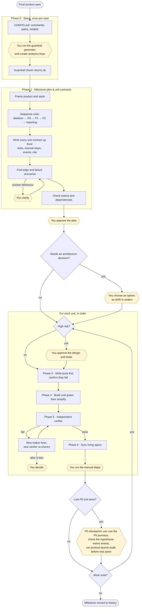

# product-engineering

Builds a product spec into working, tested code, one unit at a time. Every unit's contract is planned up front:
- automated tests;
- manual walkthroughs;
- analytics events.

Each unit is then built tests-first, checked by a separate verifier that didn't write the code, and synced back into the living specs. Guardrails act as locks, scaled to each unit's risk, not as instructions the agent could ignore.

Instructions for Claude live in [SKILL.md](SKILL.md). This page is for people.

## Flow

Yellow boxes are where the skill stops and waits for you.

## Where it stops for you

| Stop | What you do |
|---|---|
| Phase 0 setup | Run the guardrail generator yourself, and create the dev and prod analytics keys. The agent never handles them. |
| Unclear behaviour | Answer a concrete question with options. The agent never guesses product behaviour. |
| Plan checkpoint | Approve the milestone plan, unit contracts and ADRs before any code. |
| Architecture decision | Choose between options; the decision is recorded as an ADR. |
| High-risk unit | Approve its design and locks before it's built. |
| After each unit | Run the manual walkthrough steps, including any paid live test, whose cost is shown first. |
| P0 checkpoint | Use the P0 journeys hands-on, confirm the hypothesis-metric events arrive, and run `product-launch-audit` before real users. |

## What you get

- `active/NN-<milestone>/`: a plan and one contract per unit. Moved to `history/` when the milestone is done.
- Tests written before the code at four levels: unit, integration, end-to-end and live.
- `history/decisions/`: an ADR for each architecture and guardrail decision.
- Living specs in `specs/engineering/`, kept in sync with shipped code.
- Analytics events for every journey, plus a reporting unit at the end.

## Works with

- [product-scoping](../product-scoping/README.md) supplies the spec and flows that units are built against.
- [product-design](../product-design/README.md) supplies the accepted mocks for UI units.
- [product-launch-audit](../product-launch-audit/README.md) runs before real users.
