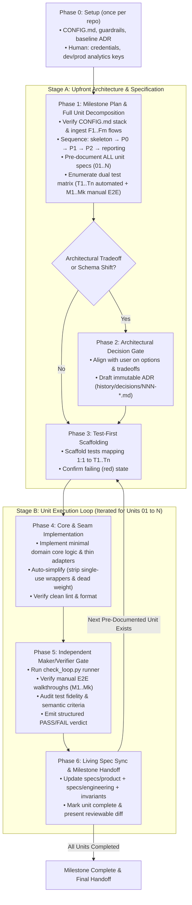

# product-loop-engineering

An end-to-end engineering operating system for building maintainable, high-integrity software. It transforms ad-hoc coding into a repeatable, spec-and-test-driven development loop.

---

## Core Tenets & System Invariants

1. **Upfront End-to-End Pre-Documentation**:
   Before writing implementation code for Unit 01, decompose the entire milestone/epic into all its sequential Build Units ($01..N$). **Pre-document every unit contract upfront** in `active/NN-<milestone>/units/` with its scope boundaries, architectural seams, dual test matrix (automated $T_1..T_n$ and manual E2E $M_1..M_k$), and acceptance criteria. Never leave downstream phases as vague one-liners. Planning everything upfront keeps early decisions from boxing in later units; **building** follows priority: walking skeleton → P0 → P1 → P2 → analytics reporting, with each unit leaving the app runnable and testable.
   $$\text{Living Spec / Roadmap} \longrightarrow \text{Pre-Document All Units } (01..N) \longrightarrow \text{Iterate } [\text{Test} \to \text{Build} \to \text{Verify} \to \text{Finalize}]$$

2. **Dual-Layer Spec-and-Test Traceability (Automated + Manual E2E)**:
   Every unit must define two complementary test layers before implementation:
   - **Automated Test Scenarios ($T_1..T_n$)**: Programmatic, deterministic CI unit/integration tests mapping 1:1 to explicit scenario tokens. For UI work, behavior that only exists in a browser (hover, focus, keyboard, JS-driven state, layout/overflow, accessible names) gets **automated browser tests** (Playwright or equivalent) named by the same tokens; source-text assertions don't count as covering it.
   - **Manual E2E Scenarios ($M_1..M_k$)**: Concrete, step-by-step user-verifiable browser/device walkthroughs specifying exact user actions, expected visual changes, and error recovery states. They cover what automation can't judge (visual feel, third-party pages) and act as a human sanity pass over key flows, even ones the browser suite already automates.

3. **Architectural Seams & Determinism**:
   Deterministic domain logic lives in isolated core modules (`lib/`, domain packages, core models). Route handlers, API endpoints, and CLI tools are thin adapters. Multitenancy, permissions, and scoping boundaries are enforced structurally at the data access seam, making unscoped leaks impossible.

4. **Maker / Verifier Independence**:
   The session or agent that writes the code **must not self-approve** its own work. An independent verification pass audits mechanical CI facts, test fidelity, manual E2E repeatability, and semantic acceptance criteria without maker rationalization.

5. **Living Documentation & Safe Git Hygiene**:
   Three top-level documentation directories, by lifecycle:
   ```
   active/                       # work in progress
     NN-<milestone>/
       plan.md                   # roadmap + status tracker
       units/NN-<slug>.md        # unit contracts
   specs/                        # what the system is today
     README.md                   # index: system overview, links to both halves
     product/                    # what & why
     engineering/                # how
   history/                      # append-only record of change
     decisions/NNN-<slug>.md     # ADRs
     milestones/NN-<milestone>/  # finished active/ folders, moved here intact
   ```
   - **Active work (`active/NN-<milestone>/`)**: the milestone plan (unit sequence, target end state, migration matrices, status tracker) and its unit contracts. Planning artifacts never live in `specs/`.
   - **Living Specs (`specs/`)**: source of truth for what the system does *today*. Describe only what has shipped: no roadmaps, unbuilt features, or "will" statements. Never use strikethroughs or describe decommissioned designs. Gaps between intent and reality are listed explicitly as **Known Gaps**. A spec outlives the milestone that created it.
     - **`specs/product/`**: requirements from the user's side: who it is for, goals, required capabilities and content, constraints, non-goals. Can be a single short `README.md` for small products.
     - **`specs/engineering/`**: design from the builder's side, one file per system layer / subsystem (e.g. `platform.md`, `contact.md`), never per milestone.
   - **History (`history/`)**:
     - **Decision Records (`history/decisions/NNN-*.md`)**: ADRs capturing *why* choices, pivots, and cuts occurred. Written here directly when the decision is made. Once accepted, never edited; a new ADR supersedes an old one.
     - **Completed Milestones (`history/milestones/NN-*/`)**: when every unit is done, move the whole `active/NN-*/` folder here. Contracts are then frozen.
   - **Git Safety**: Git is version control, so commits and pushes are allowed and can be rolled back. Commits follow `AUTO_COMMIT` in `CONFIG.md`; when it is `false` (the default), leave diffs uncommitted for human inspection. Only what git can't undo is denied: force-push, `reset --hard`, `clean -f`, and secrets or user data entering a commit.

6. **Instrumented by Default**:
   Every journey unit ships the analytics events for what it builds: one view and one primary-action event per capability, plus the events behind the spec's hypothesis metric in the P0 journeys. The milestone's last unit turns those events into a dashboard, reports, or saved queries against the analytics platform's API or MCP (`ANALYTICS_PLATFORM` in `CONFIG.md`). Dev and prod send to separate analytics projects with separate keys, so test traffic never pollutes real metrics; the accounts and keys come from a human in Phase 0.

7. **Enforced Guardrails, Not Prompts**:
   A prompt is a keep-out sign; a guardrail is a lock the environment enforces. Lock only what git can't undo; everything git can roll back gets a check instead. Phase 0 installs the baseline locks (secret reads denied, guardrail config protected, commands that destroy uncommitted work or act outside the repo blocked, a dev login that can't delete) and the privacy gates every commit passes (no secret files tracked or un-ignored, no user-data files outside `tests/fixtures/`, no secrets, card numbers or SSNs in changed files, synthetic test data only), generated from one agent-neutral file, `.agent/guardrails.json`, by `scripts/gen_guardrails.py`. Every unit carries a **Risk** level (low / medium / high, from blast radius and reversibility; unsure means higher) and a **Guardrails ADR**: low risk cites the baseline ADR, medium and high write their own, as does any design-system change. The higher the risk, the more locks, the stricter the verifier. Runtime locks for AI features inside the app are built by the unit that adds them and audited at launch by `product-launch-audit`. Full detail: [Guardrails](references/guardrails.md).

8. **Roles at Model Tiers, Not Model Names**:
   Each phase runs as a role at a tier (top, mid, small); `CONFIG.md` maps tiers to each tool's models, and `scripts/gen_guardrails.py` writes one subagent per role with its model.

   | Role | Phases | Tier | Gets |
   | :--- | :--- | :--- | :--- |
   | Planner / orchestrator (main session) | 0–2, then spawns the rest and relays `BLOCKED:` questions to the user | top | Everything |
   | `loop-maker` (`loop-maker-high` for high risk) | 3–4 | mid (high risk: top) | Contract path only |
   | `loop-verifier` (`loop-verifier-strict` for medium and high risk) | 5 | mid (medium/high: top) | Contract path, diff, `check_loop.py` JSON |
   | `loop-scribe` | 6 | small | Contract path, verdict table, diff |

   Planning errors compound across every unit, so planning gets the top tier; the build spends the most tokens, so it gets mid. Never put the verifier below mid: a weak verifier approves what it's shown. Tests are never written at the small tier. Name roles in prompts and docs, never models. If the main session runs below `PLANNER_TIER`, say so before Phase 1. Codex agents use underscores (`loop_maker`).

---

## Setup + the 6-Phase Engineering Loop



---

### Phase 0: Setup & Safeguards (once per repo)

**Goal**: Locks and accounts exist before any unit is planned. Skip when `check_loop.py guardrails` already returns `"ok": true`.

1. **Config**: copy `CONFIG.example.md` to the repo root as `CONFIG.md` (not into the skill folder, which may be a symlink shared across repos) and set the commands, paths, breakpoints, and analytics fields for this stack.
2. **Guardrails** (a human runs it; the generated files are protected from the agent): `scripts/gen_guardrails.py --init --git-hook` generates `.agent/guardrails.json` plus each agent's config (Claude deny rules and PreToolUse hook, ignore files, an `AGENTS.md` block, a pre-commit check). Set `adr_required_paths` to where this repo's design system lives. The agent drafts the **baseline guardrails ADR** (`templates/GUARDRAILS_ADR_TEMPLATE.md`). Details: [Guardrails](references/guardrails.md).
3. **Human-only steps**: stop and ask for these, with exact instructions. Never work around a missing one.
   - A dev database login without `DELETE`/`DROP`; no production credentials in the agent's environment.
   - Analytics accounts: separate **dev** and **prod** projects in `ANALYTICS_PLATFORM` (plus a prod `ACQUISITION_ANALYTICS` property), each with its own key. Dev key in the local `.env`, prod key in the host's secret settings. The agent never reads either; code picks the key by environment.
4. **Check**: `check_loop.py guardrails` returns `"ok": true`. Phase 1 doesn't start until it does.

---

### Phase 1: Milestone Planning & Full Unit Pre-Documentation

**Goal**: Iron out architectural seams, edge cases, and dependencies by pre-documenting all build units across the entire milestone *before* touching code.

1. **Product Framing & Stack Alignment**:
   - Inspect `CONFIG.md` and existing `specs/engineering/` to detect the repository's tech stack and storage layer. Only ask about stack or database choices on a brand-new empty repository; for new features in an existing codebase, reuse the established stack and only surface feature-specific tradeoffs.
   - Ingest `specs/product/`: its prioritized scope and tier-tagged Key User Flows ($F_1..F_m$ `[P0|P1|P2]`). If it doesn't exist, define them with the user first: user outcomes, user stories, out-of-scope boundaries, and a P0/P1/P2 tier per flow, where P0 is the flows that test the riskiest assumption.
   - Frame tradeoffs in terms of user experience (gains vs. losses) and concrete engineering cost. If non-obvious architectural forks exist, **ask the user first** with concrete options before generating unit files.
2. **Sequence and Decompose the Entire Milestone Upfront**:
   - Break the initiative into bounded Build Units ($01..N$) covering **every** P0–P2 flow, in this order:
     1. **Walking skeleton** (`infra`): app shell, data layer, one end-to-end round trip, test/lint running. Only what every journey needs.
        **Launch-hygiene basics go in the skeleton**: real git repo with a remote, secrets only in env (`.env` gitignored), error tracker installed, analytics and session replay initialized with the Phase 0 keys (dev key locally, prod key only in production), rate limit on public and login endpoints, every data-touching route behind auth, and it cites the baseline guardrails ADR. Cheap now, painful to retrofit.
     2. **Load-bearing decisions** go in the skeleton even when the feature using them is P2: choices that are expensive to retrofit (data scoping key such as `owner_id`/`tenant_id`, ID scheme, sync model, auth seam as an interface). Record each as an ADR.
     3. **P0 journeys**, then **P1**, then **P2**. Feature-specific infrastructure (external API seam, eval harness, invite tables, scheduler) arrives just in time, as an `infra` unit right before the first journey that needs it.
     4. **Reporting** (last unit): dashboard, reports, or saved queries over the events instrumented by earlier units, built through the analytics platform's API or MCP.
   - **Testable after every unit**: each unit leaves the app runnable and states what a human can try once it ships. Infra units prove themselves through the skeleton's round trip or a runnable harness, never "nothing visible yet."
   - Create a dedicated unit spec for **every single unit** upfront using `templates/UNIT_TEMPLATE.md` under `active/NN-<milestone>/units/NN-<slug>.md`, with `Type`, `Serves` (flows), `Tier`, `Risk` and `Guardrails ADR` filled in. **Risk** is low, medium or high from the unit's worst case and whether it can be undone (unsure: take the higher level); low risk cites the baseline ADR, medium and high write their own, as does any design-system change.
   - Ensure no unit is left as an unspecified placeholder.
   - Write the milestone roadmap and status tracker to `active/NN-<milestone>/plan.md` using `templates/PLAN_TEMPLATE.md`. Do **not** put it in `specs/`.
   - In each unit contract, fill **Living Specs Affected**: which `specs/product/` and `specs/engineering/` files the unit will create or update once it ships.
3. **Formulate Dual Test Matrix via Scenario Discovery**:
   - **Read `references/scenarios.md` before writing any T or M scenario.** Walk each flow ($F_1..F_m$) across its 8 dimensions: Actor/Auth, Flow Paths/Abandonment, Data Volumes/Zero State, Input Boundaries, AI Failures, Human Agency/Recovery, Network/Concurrency, Platform/A11y.
   - **Read `references/test-mapping-guide.md` to place each scenario**: automated (T) or manual (M), and which test level (unit, integration, browser, eval).
   - Fill the unit's **Scenario Coverage** table: each dimension lists the T/M tokens covering it, or a one-line reason it's skipped (doesn't apply, or low value for this unit). Consider every dimension; don't test every one.
   - **Scenario Clarification Gate**: if expected behavior for any scenario is ambiguous or has several valid UX readings, **STOP before generating unit contracts** and ask the user (protocol: `references/scenarios.md` §2). Never guess product behavior.
   - **Part A: Automated Test Scenarios ($T_1..T_n$)**: Programmatic CI assertions covering deterministic logic, dirty payloads, schema repair, boundary inputs, and security invariants. Medium and high risk add a `[Guardrail]` scenario per lock (the blocked action stays blocked); high risk adds an `[Abuse]` scenario (injection, wrong-tenant access, replay):
     - `- **T1 [Happy Path]** — ...`
     - `- **T2 [Edge Case / Malformed Input]** — ...`
     - `- **T3 [Boundary / Security / Invariant]** — ...`
   - **Part B: Manual E2E Scenarios ($M_1..M_k$)**: Step-by-step user-verifiable browser/device walkthroughs covering key flows, visual states, and human recovery/override paths:
     - `- **M1 [Desktop Happy Path]** — Steps: 1. ... 2. ... Expected: ...`
     - `- **M2 [Mobile / Responsive State]** — Steps: 1. ... Expected: ...`
     - `- **M3 [Error State & Recovery / Human Override]** — Steps: 1. ... Expected: ...`
   - **Part C: Instrumentation**: the analytics events the unit emits (name, trigger, properties). Journey units need a view and primary-action event per capability; P0 journeys also emit the hypothesis-metric events.
   - **Viewport coverage (UI units)**: follow the `VIEWPORT_BREAKPOINTS` and `PARITY_REFERENCE_URL` rules in `CONFIG.md`.
4. **Validate Seam & Dependency Topology**:
   - Check data flow between units: Does Unit 02 rely on a schema or seam that Unit 01 fails to output?
   - Resolve schema, API, or contract conflicts before any code is written.
   - Run the plan validator and fix every error before asking for approval:
     ```bash
     python .claude/skills/product-loop-engineering/scripts/check_loop.py plan
     ```
     It fails when a unit lacks a contract, tiers run out of order, a spec flow has no unit, reporting isn't last, or a contract is missing its type, testable outcome, M scenarios, (journey units) instrumentation events, a valid Risk, or a Guardrails ADR that exists (medium and high risk need their own ADR plus `[Guardrail]` T scenarios; high also `[Abuse]`).

---

### Phase 2: Architectural Decision Gate

**Goal**: Lock in non-obvious technical choices, migrations, API selections, or structural cuts in immutable ADRs.

1. **Trigger Conditions**:
   - Framework or runtime selections, schema migrations, third-party API provider choices, security boundaries, deliberate cuts of planned scope, and guardrails: the baseline in the skeleton, one ADR per medium or high risk unit, any loosening of a lock or lowering of a risk level (a new ADR that supersedes the old one), and design-system changes (tokens, type, color, spacing, global styles, shared components) at any risk level. UI copy needs none.
2. **Align First, Then Draft the ADR**:
   - Present the options, user/technical tradeoffs, and recommended choice to the user before locking in a major decision.
   - Once aligned, write `templates/ADR_TEMPLATE.md` under `history/decisions/NNN-<slug>.md`.
   - Capture:
     - **Context & Problem Statement**: User friction and engineering constraints.
     - **Decision**: Concrete architectural choice and boundary enforcement.
     - **Alternatives Considered & Rejected**: Concrete user/technical reasons why alternatives were dismissed.
     - **Consequences & Tradeoffs**: Explicit gains and accepted costs.

---

### Phase 3: Test-First Scaffolding

**Goal**: Write deterministic tests mapping 1:1 to the unit's pre-documented $T_1..T_n$ matrix before touching production logic.

**Who runs Phases 3–4**: spawn a fresh `loop-maker` (`loop-maker-high` for a high-risk unit). Its prompt gets the unit contract path and nothing else from planning. If it returns `BLOCKED:`, put the question to the user, record the answer in the contract, and spawn a new maker.

1. **Scaffold Test Suite**:
   - Place in `tests/<subsystem>/` or configured test directory.
   - Name test functions with matching test tokens (e.g. `test_t1_happy_path`, `test_t2_honeypot_trap`).
2. **Injectable & Deterministic I/O**:
   - Mock external networks, third-party APIs (e.g. Resend, Stripe), system clocks, or AI model calls. Patterns: `references/test-mapping-guide.md` §3.
   - Tests must run fast, offline, and deterministically.
   - The configured `TEST_COMMAND` runs every suite (unit + browser), so the gate in Phase 5 sees both.
3. **Verify Red State**:
   - Run tests to confirm they fail for the expected reasons prior to implementation.

---

### Phase 4: Core & Seam Implementation

**Goal**: Implement minimal, high-integrity code satisfying the unit contract and passing all tests.

1. **Domain Logic in Core First**:
   - Implement business logic, validations, and data models inside pure core packages/modules.
   - Keep deterministic business rules out of LLM prompts and out of thin UI glue.
2. **Thin Web/API/CLI Adapters Second**:
   - Wire route handlers, controllers, templates, and CLI endpoints.
   - Enforce multitenancy and scoping at the data access seam.
   - Emit every event in the unit's **Instrumentation** section through one analytics seam (a single `track()` wrapper), so tests can assert events with a fake sink and no vendor SDK call is scattered through UI code.
3. **Root-Cause Before Fix**:
   - When a test fails unexpectedly during implementation, read the full failure output and trace the root cause in the data flow before editing code—never guess or apply shotgun fixes, and never weaken a spec-mandated test assertion just to make it pass.
4. **Simplify & Clean Code Baseline**:
   - Once tests pass, perform an automatic simplification pass on modified files: inline single-use wrappers, remove speculative abstractions, and strip redundant comments.
   - Verify all unit tests still pass green.
   - Run project linter and formatter (via configured `LINT_COMMAND` and `FORMAT_COMMAND`).

---

### Phase 5: Independent Maker/Verifier Gate

**Goal**: Perform an independent, multi-tiered audit of the implementation against the pre-documented acceptance criteria.

> [!IMPORTANT]
> **Independence Invariant**: The maker agent never signs off on its own work. A separate verification pass audits code, test assertions, manual E2E reproducibility, and observed behavior against the unit spec without rationalization.

**How to run it independently**:
- Run `check_loop.py fingerprint`, then spawn a fresh `loop-verifier` subagent (`loop-verifier-strict` for medium and high risk; both generated in Phase 0). Its prompt gets only: the unit contract path, `git diff` of the unit's changes, the `check_loop.py` JSON, and the verifier steps below. Never pass the maker's reasoning, summaries, or "known issues" notes.
- The verifier reads and runs; it can't edit. It has no write tools, and the guard hook limits its Bash to read-only commands, `check_loop.py`, and `verifier_bash_allow`. When it returns, run `check_loop.py fingerprint` again: a different hash voids the verdict, so re-run with a new verifier. It returns the verdict table plus a findings list (file:line, expected vs. observed). Each finding quotes the code line it rests on and carries a certainty from 1 to 10. Findings at 7+ block a PASS (5+ for high-risk units); 4–6 go under **Unverified** (listed, non-blocking); below 4 are dropped.
- On FAIL, a new maker gets the contract path plus the findings and fixes them, and a **new** verifier subagent re-runs the full gate. Don't reuse the old one or narrow its scope to the fixes. After 3 fix → re-verify cycles, stop and ask the user.
- If no subagent tool exists, stop and ask the user to run verification in a separate session on the verifier tier's model, with the same inputs and the same fingerprint check. Don't verify inline. The same fallback applies to every role: a fresh session on that role's model, given only that role's inputs.

1. **Mechanical CI Gate (Deterministic)**:
   Run the verification runner:
   ```bash
   python .claude/skills/product-loop-engineering/scripts/check_loop.py NN
   ```
   Inspect emitted JSON facts:
   - Test suite exit code & summary.
   - Linter & formatter exit codes.
   - Full mapping of $T_1..T_n$ test tokens (zero missing test tokens permitted).
   - `hygiene`: likely hardcoded secrets in changed files (fails the gate) and route files that mention no auth (heuristic: the verifier reads each and confirms or dismisses it with file:line).
   - `guardrails`: config present, adapters wired, no protected or append-only path edited, a new ADR for any guardrail-config or design-system change, and the privacy gates (fails the gate; `privacy_warnings` lists real-looking emails and phones for the verifier to confirm or dismiss with file:line).
   - `diff`: changed source files, and test files that lost assertions or gained skips, sleeps, or timeouts.
2. **Manual E2E Walkthrough Audit (Verification)**:
   - Step through each documented manual scenario ($M_1..M_k$).
   - Verify that UI components, responsive breakpoints, error recovery states, and navigation routes function as specified.
   - Apply the `VIEWPORT_BREAKPOINTS` and `PARITY_REFERENCE_URL` rules in `CONFIG.md`.
   - Trigger each event in the **Instrumentation** section and confirm it arrives with the listed properties (analytics debug/live view via its API or MCP, or the fake sink in tests).
3. **Test Fidelity Audit (Judgment)**:
   - Verify assertions are substantive, not tautological or hollow.
   - Check that error branches explicitly assert status codes, error types, and error messages.
4. **Semantic Acceptance Criteria Audit (Judgment)**:
   - Audit every checkbox item in the unit spec's `Acceptance Criteria` against actual code and runtime behavior.
5. **Test Edits & Scope Drift (Judgment)**:
   - For each file in `diff.test_files_to_justify`, every removed or loosened assertion must trace to a line in the unit contract that changed. A test edited to fit the code, with no contract change behind it, is a finding.
   - **Scope creep**: any hunk in `diff.source_files` that no contract line asks for (a bug fix riding along in a test-only change counts).
   - **Missing requirement**: any contract line with no code or test behind it.
6. **Guardrails Audit (Judgment)**:
   - Read the unit's **Risk** and Guardrails ADR. Confirm each lock for that level exists, and that its `[Guardrail]` / `[Abuse]` tests assert the block (status code, error, or no side effect), not just that the code path runs.
   - Diff-review any change to guardrail config or protected paths against the ADR that justifies it. High risk: confirm the work ran without real credentials.
7. **Structured Verdict Table**:
   Emit a clean sign-off table:
   ```markdown
   ### Unit NN — <Unit Name> Verification Verdict
   | Criterion / Gate | Status | Evidence |
   | :--- | :--- | :--- |
   | Automated Tests (T1..Tn) | PASS | n/n mapped and passing green |
   | Manual E2E Tests (M1..Mk) | PASS | All browser walkthroughs verified |
   | CI & Linter Gates | PASS | Tests green; 0 lint/format warnings |
   | Seam & Architecture Invariants | PASS | Logic isolated in core; scoping verified |
   | Instrumentation | PASS | All listed events fire with expected properties |
   | Semantic Acceptance Criteria | PASS | All bullet criteria verified |
   | Guardrails (risk: low/medium/high) | PASS | Locks for this level present; negative tests pass; config unchanged or ADR'd |
   | Test Edits & Scope Drift | PASS | Every test edit traced to the contract; no unrequested changes |
   | **OVERALL VERDICT** | **PASS** | **Ready for living spec sync** |
   ```

---

### Phase 6: Living Spec Sync & Milestone Handoff

**Goal**: Synchronize living specifications with current production reality and prepare clean diffs for human review.

**Who runs it**: spawn `loop-scribe` with the contract path, the verdict table, and the diff. The orchestrator reviews its file list before the checkpoint.

1. **Sync Living Specs & Compound Learnings** (mandatory; a unit is not complete until this is done):
   - Create or update every spec listed under the unit's **Living Specs Affected**, plus any other area the unit actually changed: `specs/engineering/<subsystem>.md` (use `templates/LIVING_SPEC_TEMPLATE.md`) and, if requirements changed, `specs/product/` (use `templates/PRODUCT_SPEC_TEMPLATE.md`).
   - Document shipped behavior from the code, not from the unit contract. Where the contract and the code differ, the spec follows the code and lists the difference under **Known Gaps**.
   - Record any non-obvious domain invariants discovered during implementation or verification in `specs/engineering/<subsystem>.md`, and update `CONFIG.md` if repository tooling quirks were encountered.
   - Update `specs/README.md` (index, route/module map) if routes, modules, or env vars changed.
   - Remove obsolete architectural descriptions (no strikethroughs).
2. **Update Unit Status**:
   - Mark acceptance criteria checkboxes complete in `active/NN-*/units/NN-*.md`.
   - Update the unit's status row in `active/NN-*/plan.md`.
   - Document any manual testing notes or observations.
   - If next pre-documented unit exists, queue it for Phase 3.
   - **Last unit done: clean up `active/`.** `git mv active/NN-*/ history/milestones/NN-*/` in the same pass, and repoint any links to it. `active/` holds only unfinished work; `check_loop.py plan` fails on a plan whose units are all done.
3. **Clean Review State**:
   - Present a concise summary of user impact, modified files, test results, and exact manual E2E test steps for the user.
   - Leave diffs uncommitted for human review unless `AUTO_COMMIT` is `true` in `CONFIG.md`.

---

## Stage Progression & Human Checkpoints

Do not force the user to remember or type phase subcommands. Inspect `active/`, `specs/`, and `tests/` to determine where work stands and advance naturally:

0. **Setup Checkpoint (Phase 0)**: if `check_loop.py guardrails` fails, run Phase 0 and pause for the human-only steps.
1. **Upfront Planning Checkpoint (Phases 1–2)**: Align with the user on any architectural tradeoffs first, generate `active/NN-<milestone>/plan.md` + all unit contracts (`01..N`) + any ADRs (one per medium or high risk unit), and pause for approval to start building.
   **High-risk units** pause again before building: present the design and the locks, and get approval first.
2. **Per-Unit Execution Checkpoint (Phases 3–6)**: For the current incomplete unit in `active/NN-*/plan.md`, run **Phase 3 (Test-First) $\to$ Phase 4 (Build & Simplify) $\to$ Phase 5 (Independent Verify) $\to$ Phase 6 (Spec Sync)** in one cohesive sequence, each through its role (tenet 8), then pause to present the verdict table, manual E2E walkthrough steps, and uncommitted diff before advancing to the next unit.
3. **P0 Checkpoint**: after the last P0 unit, pause before any P1 work. Have the user run the P0 journeys hands-on, and confirm the hypothesis-metric events are arriving. Before real users, run the `product-launch-audit` skill. If what they learn changes priorities, update the spec and re-run `check_loop.py plan` before continuing.

---

## Detailed References

* [Guardrails: locks, not prompts](references/guardrails.md)
* [Scenario Discovery & Clarification Guide](references/scenarios.md)
* [Universal LLM & Probabilistic Failure Archetypes](references/llm-failure-archetypes.md)
* [Test Levels & Mocking Guide](references/test-mapping-guide.md)
