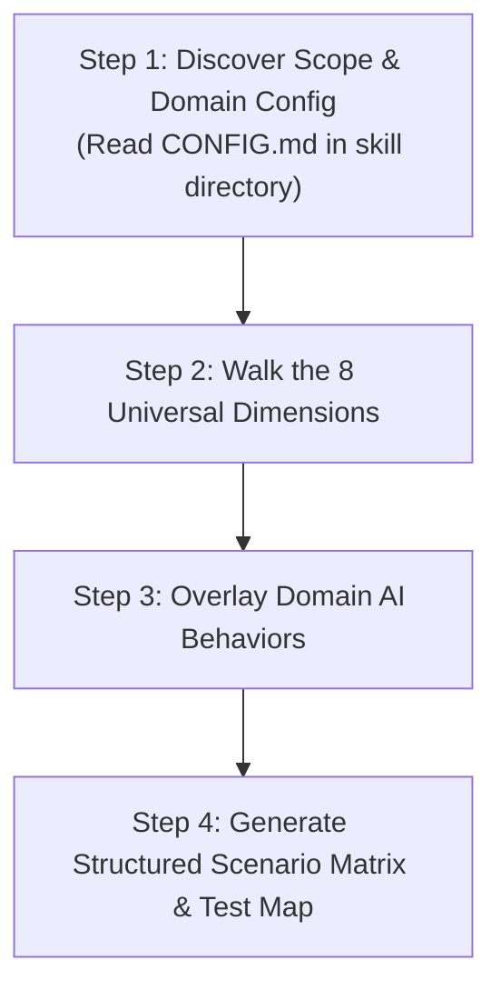

# product-scenarios

A systematic framework for discovering, mapping, and specifying all product scenarios for any software feature. It prevents the trap of designing only for the happy path by forcing evaluation across **8 universal system dimensions** and **domain-specific AI capabilities**.

---

## Workflow: The 4-Step Scenario Mapping Loop

### Step 1: Discover Scope & Domain Config
1. Identify the feature boundary being specified.
2. Read `CONFIG.md` in this skill directory (`.claude/skills/product-scenarios/CONFIG.md` or `.agents/skills/product-scenarios/CONFIG.md`). If it does not exist, use `CONFIG.example.md` as reference.
3. Load:
   - **Domain Entities**: Core business objects and their relationships.
   - **Domain AI Scenarios**: App-specific probabilistic tasks (e.g. multi-image grouping, OCR deduplication, entity extraction).
   - **Invariants**: Non-negotiable product constraints.

### Step 2: Walk the 8 Universal Dimensions
Evaluate the feature across each universal dimension:
1. **Actor & Access Context**: Unauthenticated, authenticated, role permissions, multi-actor concurrency, session expiry.
2. **Flow Paths & Intent**: Primary happy path, alternate entry points, cancellation mid-stream, abandonment and draft recovery.
3. **Data Volumes & State**: Cold start (zero state), sparse data, nominal volume, stress/scale extremes, stale/conflicting state.
4. **Input & Payload Boundaries**: Clean input, boundary/extreme sizes, degraded/dirty inputs, corrupted/hostile payloads.
5. **Generic AI & Probabilistic Modes**: Schema compliance failure, hallucination, omission/truncation, false positives/negatives, repetition/overlap artifacts, API timeouts/rate limits.
6. **Human Agency & Override**: Glanceable verification diffs, $\le 2$-tap manual corrections, reversibility/undo, actionable errors.
7. **Network & Concurrency**: Fast network, high latency, flaky/offline transitions, double-submits, race conditions.
8. **Platform & Hardware Engine**: Mobile touch/viewport, desktop pointer/keyboard, OS sandbox limitations, accessibility.

### Step 3: Overlay Domain AI Behaviors
Layer the project-specific AI capabilities defined in `CONFIG.md`:
- Does the feature involve grouping multiple raw assets into one entity?
- Does it involve decomposing one asset into multiple entities?
- Does it involve continuous/overlapping captures (e.g. scrolling screenshots)?
- Does it involve redundant instructions or visual step captions that must be deduplicated?

### Step 4: Generate Structured Scenario Matrix & Test Map
Output a clear, numbered scenario matrix ($S_1, S_2, ...$) using the template in `references/matrix-template.md`:
- Scenario ID & Title
- Pre-conditions & Trigger
- Expected Behavior vs. Failure Mode
- Human Recovery Path
- Automated Test Level (Unit, Integration, E2E, AI Eval)

---

## Detailed References

* [Universal LLM & Probabilistic Failure Archetypes](references/llm-failure-archetypes.md)
* [Scenario Matrix Template](references/matrix-template.md)
* [Test Mapping Guide](references/test-mapping-guide.md)
