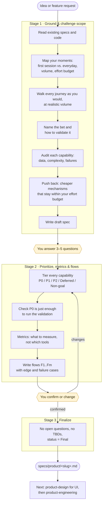

# product-scoping

Turns a product idea or feature request into a product spec at `specs/product/<slug>.md`. The spec holds:
- the core hypothesis, and how to validate it;
- capabilities ranked P0 / P1 / P2;
- the metrics to watch;
- numbered user flows (F1..Fm), which `product-engineering` builds and tests against.

The skill works from your side first: the moments you use the product, how much you throw at it, and what effort you'll tolerate. Only after that does it pick mechanisms. It pushes back on scope and stops for your answers after each stage.

Instructions for Claude live in [SKILL.md](SKILL.md). This page is for people.

## Flow

Yellow boxes are where the skill stops and waits for you.

## Where it stops for you

| Stop | What you see | What you do |
|---|---|---|
| End of Stage 1 | The draft spec path. The journey as you'd live it. The bet and how to validate it. Stories and features by tier, plus what was cut. | Answer 3–5 questions. Correct the moments and volumes first, since everything else depends on them. |
| End of Stage 2 | What your answers changed. Priorities by tier. The success measure. Each flow in a few lines. | Confirm, or change anything. Changes loop back to Stage 2. |
| Stage 3 | The final spec. | Choose whether to go to `product-design` or straight to `product-engineering`. |

You can say "skip ahead" at any stop. The rules still apply.

## What you get

- `specs/product/<slug>.md`, from [templates/PRODUCT_SPEC_TEMPLATE.md](templates/PRODUCT_SPEC_TEMPLATE.md).
- Core Hypothesis with **How to validate** and **Why this P0 is enough**.
- Flows numbered in priority order, each tagged with its tier.
- Open questions recorded in the spec with recommendations, and removed once you've answered them.

## Works with

- [product-design](../product-design/README.md) renders mocks from the spec's flows and real copy.
- [product-engineering](../product-engineering/README.md) plans, builds and tests against the flows.
