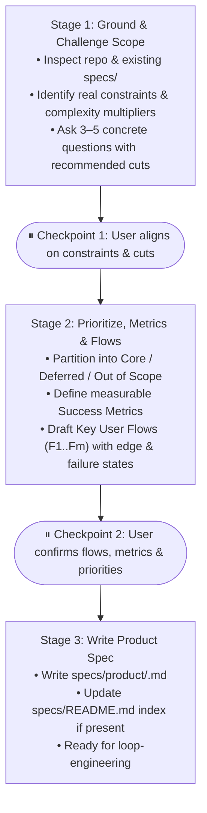

# product-scoping

Turns an ambiguous product idea or feature request into a tight, bounded product specification in `specs/product/` with measurable success metrics, prioritized scope, and enumerated user flows ($F_1..F_m$) that downstream engineering (`loop-engineering`) can build and test against directly.

---

## Core Principles

1. **Inspect Existing Reality First**:
   Before asking the user anything, inspect the repository (`specs/`, data models, routes, existing UI components). Never ask questions the codebase already answers.

2. **Grounded Constraints, Not Hypothetical Theater**:
   Do not ask artificial startup-theater questions (*"If you had to ship in 48 hours..."*, *"What is the 10-star experience?"*). Ground every question in concrete system and product constraints: data sources, persistence requirements, auth boundaries, external dependencies, and failure states.

3. **Ruthless Scope Cutting by Complexity Multiplier**:
   Evaluate every requested feature by the engineering surface area it introduces relative to the core user outcome. Explicitly flag items that require new infrastructure (extra database tables, background queues, multi-role permissions, webhook listeners, third-party sync) and recommend deferring them if the primary user flow works without them.

4. **Measurable Success Metrics**:
   Define 1–3 concrete, observable metrics that indicate whether the scoped feature achieves its goal (e.g., task completion rate, steps/time to complete, error/retry rate, latency bound, or conversion event)—never vague vanity statements.

5. **User Flows ($F_1..F_m$) as Test Foundations**:
   Every in-scope capability must be expressed as numbered, end-to-end **Key User Flows ($F_1..F_m$)** with explicit preconditions, user actions, system responses, and edge/error recovery states. These flows serve as the direct source for `loop-engineering`'s automated ($T_1..T_n$) and manual E2E ($M_1..M_k$) test matrices.

---

## Progression: 3 Checkpointed Stages

Run stage by stage. Pause after Stage 1 and Stage 2 for user decisions; do not one-shot a spec without aligning on scope cuts and user flows first unless the user explicitly asks to skip ahead.

---

### Stage 1: Ground & Challenge Scope

1. **Read the Current System**:
   - Check `specs/README.md`, `specs/product/`, and `specs/engineering/` if they exist.
   - Scan existing models, routes, or components relevant to the request.
2. **Audit Across 5 Concrete Constraint Dimensions**:
   - **Actor & Trigger**: Who initiates this workflow, what state are they starting from, and what permissions/auth boundary applies?
   - **Outcome & Success Metric**: What measurable user or system signal proves this feature succeeded?
   - **Data & Persistence**: Where does the input data come from, what must be persisted vs. computed on the fly, and what does the cold start (zero-data state) look like?
   - **Complexity Multipliers**: Which parts of the request introduce new tables, async jobs, external API dependencies, or multi-actor state? Can a simpler mechanism achieve the same user outcome first?
   - **Failure & Boundary Reality**: What happens when input is malformed, empty, exceeds limits, or an external service fails?
3. **Ask 3–5 Grounded Questions + Proposed Cuts**:
   - Keep questions specific, analytical, and paired with a concrete recommendation explaining the mechanism/cost tradeoff:
     - *Good*: "Persisting saved filters across devices requires a new `saved_filters` table and user auth check, whereas URL query parameters give shareable/bookmarkable filters with zero schema changes. Recommend URL params for Core and deferring DB persistence."
     - *Bad*: "If you only had 48 hours to launch, would you really need saved filters?"
   - **Stop and wait for the user's response.**

---

### Stage 2: Ruthless Prioritization, Metrics & Key User Flows ($F_1..F_m$)

Once the user responds to Stage 1:

1. **Partition Features into 3 Strict Tiers**:
   - **Core (Build Now)**: Capabilities strictly required for the primary user workflow to function end-to-end.
   - **Deferred (Next Milestone)**: Valid features cut from the initial milestone because they add disproportionate surface area without blocking the core flow. State the specific complexity mechanism saved for each deferred item.
   - **Out of Scope (Non-Goals)**: Capabilities and behaviors explicitly excluded.

2. **Define Measurable Success Metrics**:
   - Specify 1–3 concrete metrics tied to the Core workflow:
     - **Metric**: What is measured (e.g., *End-to-end flow completion time*, *Extraction accuracy on valid inputs*, *Zero unhandled 500s on malformed input*).
     - **Target / Threshold**: Specific number or bound (e.g., *$\le 2$ user actions*, *$< 500\text{ms}$ response*, *$\ge 95\%$ success rate*).
     - **How Measured**: Where/how it is observed (e.g., *event log, API timing, or test benchmark*).

3. **Enumerate Key User Flows ($F_1..F_m$)**:
   Translate the Core capabilities into numbered user flows that downstream engineering will use to build tests:
   - **`F1 — [Flow Name]`** (e.g., *Primary Happy Path*)
     - **Actor & Precondition**: Starting state, route/screen, and data state.
     - **Steps**:
       1. User does `[action]` $\to$ System responds with `[observable result / state change]`.
       2. User does `[action]` $\to$ System responds with `[observable result / state change]`.
     - **Expected End State**: Final user-visible outcome and persisted state.
     - **Edge & Error Cases**:
       - *Cold Start / Empty State*: Behavior when no data exists yet.
       - *Invalid / Boundary Input*: Validation behavior and recovery path.
       - *Failure Recovery*: Behavior if an operation or dependency fails mid-flow.

   *(If the feature involves complex multi-actor concurrency, offline state, or probabilistic/AI outputs, cross-check against `product-scenarios` dimensions to ensure no critical failure mode is missed.)*

4. **Present Prioritization, Metrics & Flows for Confirmation**:
   - Show the Core / Deferred / Out of Scope breakdown, Success Metrics, and $F_1..F_m$ flows.
   - **Stop and confirm with the user before writing the spec file.**

---

### Stage 3: Write the Product Specification

Once confirmed:

1. **Write `specs/product/<slug>.md`** (or `specs/product/README.md` for small single-surface products) using `templates/PRODUCT_SPEC_TEMPLATE.md`.
   - Describe behavior from the user's side: what the product does, for whom, measurable success metrics, prioritized requirements, $F_1..F_m$ user flows, constraints, non-goals, and known gaps.
   - Keep internal implementation details (file paths, function names, library internals) out of `specs/product/`; those belong in `specs/engineering/` during `loop-engineering`.
2. **Update `specs/README.md`** (if present) to link the new or updated product spec.
3. **Handoff**: Summarize the written spec path and note that it is ready for `loop-engineering`.
