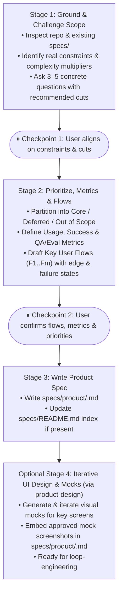

# product-scoping

Turns an ambiguous product idea or feature request into a tight, bounded product specification in `specs/product/` with measurable success metrics, prioritized scope, and enumerated user flows ($F_1..F_m$) that downstream engineering (`loop-engineering`) can build and test against directly.

---

## Core Principles

1. **Inspect Existing Reality First**:
   Before asking the user anything, inspect the repository (`specs/`, data models, routes, existing UI components). Never ask questions the codebase already answers.

2. **Grounded Constraints, Not Hypothetical Theater**:
   Do not ask artificial startup-theater questions (*"If you had to ship in 48 hours..."*, *"What is the 10-star experience?"*). Ground every question in concrete system and product constraints: data sources, persistence requirements, auth boundaries, external dependencies, and failure states.

3. **Ruthless Scope Cutting by Complexity Multiplier**:
   Evaluate every requested feature by the engineering surface area it introduces relative to the core user outcome. Explicitly flag items that require new infrastructure (extra database tables, background queues, multi-role permissions, webhook listeners, third-party sync) and recommend deferring them if the primary user flow works without them. Never invent unrequested features just to pad the `Deferred` or `Non-Goals` sections—only list items that came from the user's request or were explicitly clarified during scoping.

4. **Four-Tier Metrics Framework (Usage, Feature Success, Production Quality, Pre-Release QA/Eval)**:
   Define four distinct categories of metrics:
   - **Usage & Adoption Metrics**: Broken down into *Onboarding & Activation* (signup-to-workspace, multi-member join, time-to-first-value), *Key Screen & Feature Usage* (views and actions per core surface), and *Engagement & Retention* (DAU/WAU/WAF, week-over-week cohort retention).
   - **Feature Success Metrics**: End-to-end funnel conversion and user-value signals showing the workflow solved the user's problem (e.g., upload-to-approval conversion, plan-to-shopping completion rate).
   - **Production Quality & Reliability Metrics**: Live monitoring of AI/parser quality and system health in the wild using implicit user-feedback proxies and runtime telemetry (e.g., field-level manual edit rate/edit distance before approval, parser empty/fallback rate, API p50/p95 latency, error/timeout rate, multi-device sync latency).
   - **Pre-Release QA & Offline Eval Metrics**: Offline benchmark gates and deterministic invariants checked before shipping (e.g., extraction accuracy on a golden dataset of fixture inputs, $0\%$ hallucination on negative fixtures, $100\%$ deterministic logic accuracy across `T1..Tn` test cases).

5. **User Flows ($F_1..F_m$) as Test Foundations**:
   Every in-scope capability must be expressed as numbered, end-to-end **Key User Flows ($F_1..F_m$)** with explicit preconditions, user actions, system responses, and edge/error recovery states. These flows serve as the direct source for `loop-engineering`'s automated ($T_1..T_n$) and manual E2E ($M_1..M_k$) test matrices.

---

## Progression: 3 Checkpointed Stages (+ Optional UI Design Pass)

Run stage by stage. Pause after Stage 1 and Stage 2 for user decisions; do not one-shot a spec without aligning on scope cuts and user flows first unless the user explicitly asks to skip ahead.

---

### Stage 1: Ground & Challenge Scope

1. **Read the Current System**:
   - Check `specs/README.md`, `specs/product/`, and `specs/engineering/` if they exist.
   - Scan existing models, routes, or components relevant to the request.
2. **Audit Across 5 Concrete Constraint Dimensions**:
   - **Actor & Trigger**: Who initiates this workflow, what state are they starting from, and what permissions/auth boundary applies?
   - **Outcome & Success Metric**: What measurable user or system signal proves this feature succeeded?
   - **Data & Persistence**: Where does the input data come from, what must be persisted vs. computed on the fly, and what does the cold start (zero-data state) look like?
   - **Complexity Multipliers**: Which parts of the request introduce new tables, async jobs, external API dependencies, or multi-actor state? Can a simpler mechanism achieve the same user outcome first?
   - **Failure & Boundary Reality**: What happens when input is malformed, empty, exceeds limits, or an external service fails?
3. **Ask 3–5 Grounded Questions + Proposed Cuts**:
   - Keep questions specific, analytical, and paired with a concrete recommendation explaining the mechanism/cost tradeoff:
     - *Good*: "Persisting saved filters across devices requires a new `saved_filters` table and user auth check, whereas URL query parameters give shareable/bookmarkable filters with zero schema changes. Recommend URL params for Core and deferring DB persistence."
     - *Bad*: "If you only had 48 hours to launch, would you really need saved filters?"
   - **Stop and wait for the user's response.**

---

### Stage 2: Ruthless Prioritization, Metrics & Key User Flows ($F_1..F_m$)

Once the user responds to Stage 1:

1. **Partition Features into 3 Strict Tiers**:
   - **Core (Build Now)**: Capabilities strictly required for the primary user workflow to function end-to-end.
   - **Deferred (Next Milestone)**: Valid features from the user's request cut from the initial milestone because they add disproportionate surface area without blocking the core flow. State the specific complexity mechanism saved. Do not invent unrequested features.
   - **Out of Scope (Non-Goals)**: Capabilities and behaviors explicitly excluded during scoping.

2. **Define the 4 Metric Categories**:
   - **Usage & Adoption Metrics**:
     - *Onboarding & Activation*: Workspace creation/join rate, multi-member join rate, time to first value (TTFV).
     - *Key Screen & Feature Usage*: Views and primary actions across each core screen/feature.
     - *Engagement & Retention*: Active users/workspaces (DAU/WAU/WAF) and cohort retention (W1, W4).
   - **Feature Success Metrics**: Funnel completion and outcome metrics proving the feature delivered user value (e.g., upload-to-approval rate, plan-to-shopping completion rate).
   - **Production Quality & Reliability Metrics**: Live monitoring of AI/parser quality and system health in production (e.g., field-level manual edit rate/distance before approval, parser empty/fallback rate, p50/p95 latency, timeout/error rate, sync latency).
   - **Pre-Release QA & Offline Eval Metrics**: Offline benchmark gates and deterministic invariants verified before release (e.g., golden-dataset extraction accuracy, $0\%$ hallucination on negative fixtures, $100\%$ deterministic logic pass rate).

3. **Enumerate Key User Flows ($F_1..F_m$)**:
   Translate the Core capabilities into numbered user flows that downstream engineering will use to build tests:
   - **`F1 — [Flow Name]`** (e.g., *Primary Happy Path*)
     - **Actor & Precondition**: Starting state, route/screen, and data state.
     - **Steps**:
       1. User does `[action]` $\to$ System responds with `[observable result / state change]`.
       2. User does `[action]` $\to$ System responds with `[observable result / state change]`.
     - **Expected End State**: Final user-visible outcome and persisted state.
     - **Edge & Error Cases**:
       - *Cold Start / Empty State*: Behavior when no data exists yet.
       - *Invalid / Boundary Input*: Validation behavior and recovery path.
       - *Failure Recovery*: Behavior if an operation or dependency fails mid-flow.

   *(If the feature involves complex multi-actor concurrency, offline state, or probabilistic/AI outputs, cross-check against `product-scenarios` dimensions to ensure no critical failure mode is missed.)*

4. **Present Prioritization, Metrics & Flows for Confirmation**:
   - Show the Core / Deferred / Out of Scope breakdown, all 3 metric categories, and $F_1..F_m$ flows.
   - **Stop and confirm with the user before writing the spec file.**

---

### Stage 3: Write the Product Specification (+ UI Design Handoff)

Once confirmed:

1. **Write `specs/product/<slug>.md`** (or `specs/product/README.md` for small single-surface products) using `templates/PRODUCT_SPEC_TEMPLATE.md`.
   - Describe behavior from the user's side: what the product does, for whom, the 3 metric categories, prioritized requirements, $F_1..F_m$ user flows, UI Design & Mocks placeholder, constraints, non-goals, and known gaps.
   - Keep internal implementation details (file paths, function names, library internals) out of `specs/product/`; those belong in `specs/engineering/` during `loop-engineering`.
2. **Update `specs/README.md`** (if present) to link the new or updated product spec.
3. **Handoff to Iterative UI Design (`product-design`) or Engineering (`loop-engineering`)**:
   - For UI-facing products, offer to run `product-design` next as a separate iterative phase to explore directions, render screen mocks using the real copy/flows from the PRD, and embed the chosen mock screenshots into `## UI Design & Mocks` in `specs/product/<slug>.md` before starting `loop-engineering`.
